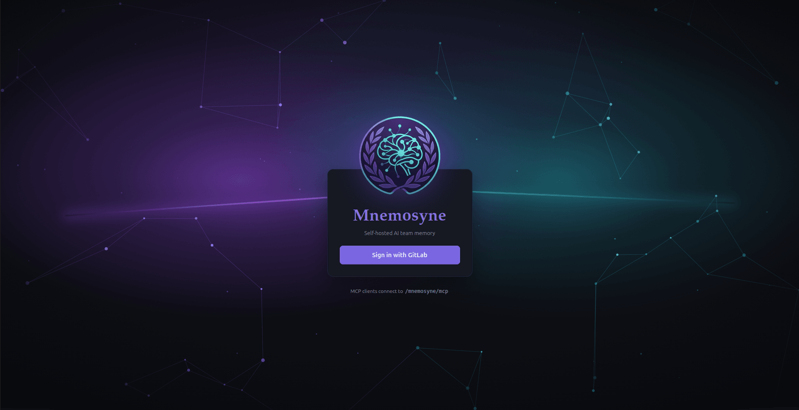
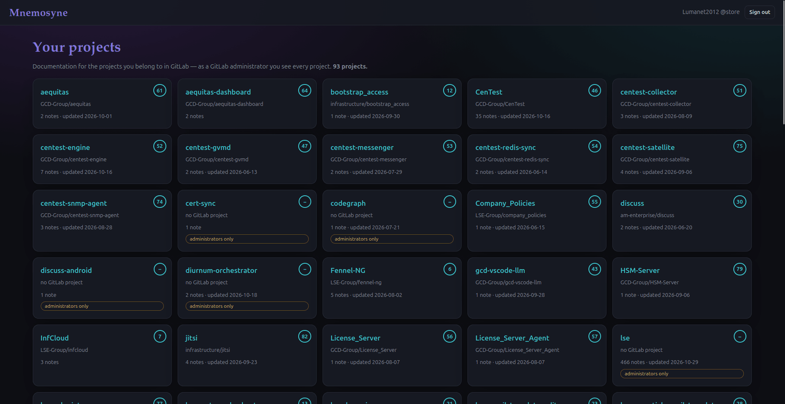
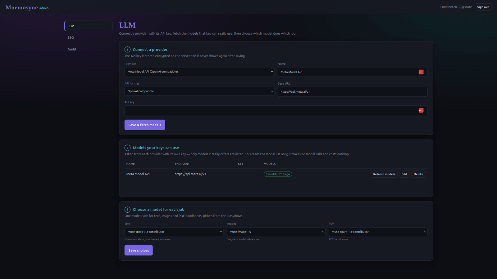
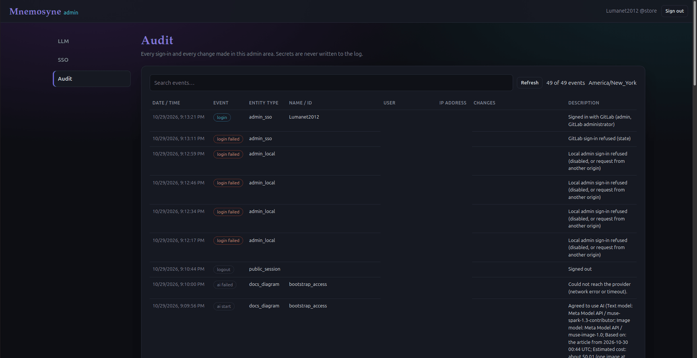

<p align="center">
  
</p>

# Mnemosyne

**Self-hosted AI team memory that writes and refreshes a Corporate Wiki for every project. Running on 92 real GitLab projects.**

A git-backed graph of memory *nodes* — what is where, what state it is in, when it was done, how — that any MCP-capable AI reads and writes, and
that Mnemosyne turns into documentation for every project of your GitLab server: a Wikipedia-style article, a workflow diagram and a PDF handbook, kept
up to date on a schedule by Meta's Muse models, with a spend limit and an agreement before anything is spent.

Open source under the [Apache License 2.0](LICENSE) · owned by GCD Investment Group, offered by LSE Group Corporation ·
a **30-day trial with everything unlocked**, then free for up to 4 seats and a licence from 5 seats ([License and seats](#license-and-seats)) · product site: <https://lumanet.info/mnemosyne>

**For judges and evaluators: a fresh install has everything unlocked for 30 days. No licence key, no seat limit, the whole audit history and GitLab sign-in for the admin area.** (The first start asks the licence server for the trial; if that server cannot be reached, the program runs as the free edition, 4 seats and the last 10 audit records, asks again every 30 minutes and unlocks everything as soon as it gets an answer; see [License and seats](#license-and-seats).) After 30 days it reverts to the free edition and keeps running.

<!-- TODO(owner): put the four judge screenshots here, in this order: Mnemosyne's own generated wiki page with its flow charts, the PDF handbook
     cover, the project grid, the spend-limit agreement popup. The existing sign-in, admin and audit screenshots stay further down. -->

## Built with Meta Muse

- **`muse-spark-1.3-contributor`** reads all the notes of a project in one call (its context takes a project's whole note history without chunking), writes the
  article — product description, features, specifications, requirements, disaster recovery — and then **plans the workflow diagram as structured data**: columns of
  boxes in the order a request travels, and the arrows between them, as JSON.
- **The diagram is drawn from that plan with exact spelling.** With an image model chosen (`muse-image-1.0` in production), the image model paints every picture of the
  plan and is given the exact words of every box and arrow, because an image model that has to invent the words misspells them (the first image-only version did).
  With no image model chosen, Mnemosyne draws the same plan itself as SVG. The rows named *IMAGES (AI flow charts)* in the admin's cost tables are the **text** tokens of the
  plan call; *PICTURES* is the image model, billed per picture.
- **Provider:** the default is Meta Model API (OpenAI-compatible). Any OpenAI-compatible or Anthropic-format provider can be used; the model per job, the limits, the
  sampling and the prompts are set in the admin.
- **Real run numbers, two separate figures.** The $0.5115 below covers the **text models only** (the three scheduled runs of 2026-10-31 happened before the image model was
  used). The image model is counted on top, per picture: see the last two sentences of this item. Text runs (admin Runs table): 176 calls, 1,071,918 tokens in, 2,021,569 out, **$0.5115 at list
  price** (text $0.2238, charts $0.2877). Cost is always counted as reported tokens × the list price of the model; the providers report tokens, not money.
  Since 2026-11-01 the workflow diagram is painted by `muse-image-1.0`, counted at the list price of $0.01 per picture (a fixed price in the code, because the provider reports
  no tokens for a picture, so it is not a figure read from a bill). The four diagrams made that way on 2026-11-01 (cost center, LLM usage tab) used 19 pictures, **$0.19**, plus
  four plan calls of the text model, **$0.0198**: $0.0444 (one plan call and four pictures) up to $0.0572 (one plan call and five pictures) per diagram.
- **Spend controls:** before an automatic schedule is saved, an agreement popup shows the estimate and the worst case (for the 92 projects on 2026-10-31: about **$0.57**
  now, at most **$2.01**; with the image model since 2026-11-01: about $0.11 now, at most $6.56) and the highest amount a month can cost; nothing runs without that one-time
  agreement; a **dollar limit per run** stops the run before a call that could pass it. Details in [docs/architecture.md](docs/architecture.md).
- **Reliability:** a provider that cannot be reached (DNS `EAI_AGAIN`, refused or reset connections) or answers 429/5xx is asked again after growing pauses (1.5 s, 3 s,
  6 s per call; 1, 2, 4 and 8 minutes per project). If one project still cannot be reached it is given up on and the run **goes on with the next project**; the run stops only
  after three projects in a row. A fixed address (host → IP, Admin → LLM) is a *fallback*: DNS is asked first and the pinned address is only used when the connection fails; the
  admin shows when the address was last verified and when it last had to stand in. (On 2026-10-31 two runs abandoned 25 and 80 projects to DNS failures before this existed.)

## What was built when

The project is owned by GCD Investment Group and offered by LSE Group Corporation. The Meta Global AI Developer Hackathon started on **2026-10-26 at 12:00 PM ET**; the
Git tag [`pre-hackathon`](https://github.com/lsegroup/mnemosyne/tree/pre-hackathon) marks the last commit before it, and the compare link shows everything since:
<https://github.com/lsegroup/mnemosyne/compare/pre-hackathon...main>. The first commit after kickoff is from 2026-10-28.

|  | Baseline (`pre-hackathon`) | Built since kickoff (net, `pre-hackathon` → `main`) |
|---|---|---|
| What | the headless MCP/REST server (TypeScript, started 2026-09-07: nine tools, SQLite FTS5 + vector search, git as the source of truth), the core library and the VS Code client | the web portal with GitLab sign-in, the Muse documentation pipeline (article, diagram plan, painted diagram, PDF handbook), the scheduler with agreement and spend limits, LLM usage (cost center), the audit trail, licence and seats, the Go admin program (first written in TypeScript, then rewritten in Go), the install zip |
| Real code (TypeScript, Go, JavaScript, HTML; without lockfiles, `nodes/`, docs, generated files, SVG, PDF) | **2,046** lines in 35 files (TypeScript 2,015, JavaScript 31) | **22,068** lines in 133 files at `main` (Go 12,419, TypeScript 8,364, HTML 986, JavaScript 299): **+20,022** lines added, 10 modified |
| Whole tree, everything `cloc` counts | 12,257 lines (9,811 of them JSON, mostly the lockfile) | 35,356 lines |

The numbers are `cloc` 2.10 output on the public history, counted on `main` at commit `a0376f6` (2026-11-03; later commits change them slightly); the raw outputs are kept in [docs/cloc-pre-hackathon-code.txt](docs/cloc-pre-hackathon-code.txt),
[docs/cloc-head-code.txt](docs/cloc-head-code.txt) and [docs/cloc-diff-code.txt](docs/cloc-diff-code.txt) (the same for the whole tree: `docs/cloc-*-all.txt`). To reproduce them:
`git clone https://github.com/lsegroup/mnemosyne && cd mnemosyne && cloc --git pre-hackathon && cloc --git HEAD && cloc --git --diff pre-hackathon HEAD` (add
`--exclude-dir=node_modules,dist,nodes,docs,bin,release,images --include-lang=TypeScript,Go,JavaScript,HTML` for the real-code count). The admin was first written in TypeScript
(2026-10-28 onward) and replaced by the Go program on 2026-11-01: the commit that removed the TypeScript admin and its scheduler deleted 3,986 lines, which are **not** in the net
numbers above, so nothing is counted twice; the compare link shows both versions in its commits.

## Editions

One code base (Apache-2.0), two editions, and a trial. The limits are applied by the admin program (`admin-go/`); a licence key (Admin → License) lifts them. **The first 30 days of every installation are a trial: everything runs, with no seat limit, the whole audit history and GitLab sign-in for the admin area, without any licence.** After 30 days it **reverts to the free edition** and keeps running (what changes: see *What changes on day 31* below).

| | Free (no key) | Licensed |
|---|---|---|
| Seats | up to **4** people — the first to sign in take the seats | the seats of the licence (**5 or more seats need a licence**) |
| Audit trail | the **last 10 records** (no paging, no search) | the whole history, paging and search |
| GitLab sign-in for the admin area (SSO) | not included: administrators sign in with the built-in account | included (and the SSO set-up in the admin) |
| Everything else (memory, MCP/REST, documentation, diagrams, PDF, Auto, LLM usage) | included | included |

## License and seats

The code is **Apache-2.0** (see [LICENSE](LICENSE), [NOTICE](NOTICE)); use, change and redistribute it as the licence says. Running a licensed edition needs a licence key
from the licence server.

- **Price:** **$8.25 per seat per month, billed annually** as an annual contract agreement: **$99 per seat per year**, for 5 or more seats. **Price breaks:** a 10% discount applies from 5 to 50 seats ($89.10 per seat per year); for more than 50 seats, contact us for an Enterprise discount deal. Buy online: <https://lumanet.info/shop/lse-mnemosyne-licence-per-seat-annual-contract-20>; licences and support: <https://lumanet.info/mnemosyne>.
- **Open core, honestly:** the limits above are in the source of the admin program (`admin-go/internal/web/license.go`), which is Apache-2.0: anyone may build and change their own
  copy. What a licence buys is a key that the official licence server issues and validates online, the official binaries and support. The licence server is not in this repository.
- **The 30-day trial:** the first 30 days of every installation have all features and no limits, without a key. The 30 days are counted by the licence server from the first time it saw the installation's address or domain (the installation id and the last answer are kept in the sealed file `license.enc`), so deleting local files does not restart them. The admin's License tab shows the days left and what changes afterwards.
- **What changes on day 31** (it reverts to the free edition and keeps running; nothing is shut down, deleted or made read-only): **seats** - the people who already hold a seat keep it and keep working normally, even beyond the fourth; nobody new is admitted until seats are freed below 4 (Admin → Users → *Free this seat*) or a licence key is entered; **audit** - the Audit tab shows the last 10 records (the log keeps recording everything, and the whole history is back with a licence); **admin sign-in** - GitLab sign-in for the admin area stops and administrators sign in with the built-in account, so set `MNEMOSYNE_LOCAL_ADMIN_USER` and `MNEMOSYNE_LOCAL_ADMIN_PASSWORD` before the trial ends (the License tab warns while none is set).
- **What an installation without a licence does after the trial** (verified in the code and its tests):
  - *Sign-in:* people sign in to the documentation portal with GitLab as usual; the first four take the seats. Administrators sign in to the admin area with the built-in
    account (`MNEMOSYNE_LOCAL_ADMIN_USER` and `MNEMOSYNE_LOCAL_ADMIN_PASSWORD`, or `..._PASSWORD_HASH`); GitLab sign-in for the admin area and the SSO set-up are refused
    ("Setting up GitLab SSO for the admin area needs a licence...").
  - *Audit page:* the last 10 records only, whatever is asked; no paging, no search, with a note that a licence shows the whole history.
  - *At the limit:* the fifth person gets HTTP 402 and a page saying *"All 4 seats of this installation are taken. Mnemosyne is free for up to 4 people; a licence key lifts the
    limit."*, and is signed out of the portal. The four who hold seats keep working; anonymous requests and `/health` are never touched. One audit entry per refused person per hour.
  - *Licence server:* asked for the 30-day trial at the first start (see below); after the trial, only when a key has been entered. During the 30-day trial everything above is unlocked, with no seat limit.
- **What the licence check sends** (`admin-go/internal/license/license.go`, `call`) - for the trial ping as well as for a licence - to the licence server only `product`, `domain` (the host of the public URL), `db_uuid` (a random
  id made at first start), `version`, `seats_used` (a number), a random `nonce` and the licence `key`. **Notes, project names and documentation are never sent.** The answer is an
  Ed25519-signed attestation, verified with a public key compiled into the program.
- **When the licence server is unreachable:** the last good attestation stays in force until it expires (7 days: `TOKEN_TTL_DAYS` of the licence server); the program asks every
  12 hours and retries every 30 minutes. After that, or if the licence server says no (revoked, expired), the installation **reverts to the free edition** and keeps running — no data is touched; a licence that is within its renewal period after it ran out counts as licensed. There is **no offline licence** in the code today.
  A system clock set back is noticed. The trial is counted by the licence server from the first time it saw the installation's address or domain, so deleting local files does not restart it.
- **For judges and evaluators:** no key is needed. A fresh install is inside its 30-day trial, so the audit history, GitLab sign-in for the admin area and any number of seats are all there. (An installation that was started more than 30 days ago shows the free edition. One that cannot reach the licence server at all, for example behind a network that blocks it, also runs as the free edition and asks again every 30 minutes; the 30 days begin when the licence server first answers.)

## What it does

- **Memory:** markdown files with YAML frontmatter in a git repo are the source of truth; `git log` is the audit trail. Embedded SQLite search — FTS5 (lexical) + `sqlite-vec`
  (semantic), fused with RRF — no search daemon, tens of MB resident.
- **Interfaces:** one core behind MCP over stdio, MCP over Streamable HTTP, and plain REST. Nine tools: `search_memory` · `get_node` · `get_node_history` · `create_node` ·
  `update_node` · `link_nodes` · `link_node_to_code` · `neighbors` · `reindex`.
- **Corporate wiki:** people sign in with GitLab and see the documentation of the projects they belong to. An administrator generates (or schedules) the article for a project
  from all of its notes, the workflow diagram, and a PDF handbook with cover, index and the diagram pages. A new diagram run replaces every earlier diagram of the project.
- **LLM usage:** the cost center — every AI job, who started it, what each model used, what it cost, per month.
- **Personal MCP tokens:** every person can issue their own token (1 to 90 days, shown once, revocable) from their profile.
- **Model-agnostic and private:** reading and writing memory never calls a model; embeddings and the optional `extract` / `/ask` features target any OpenAI-compatible gateway, and
  with none configured it runs fully offline. Git is the only hard requirement.

## Quick start

Download `release/mnemosyne_<version>.zip` (one zip per release, checksums in `release/SHA256SUMS`), unpack it and run the installer on a Linux server with systemd, Node.js 20+,
git and curl:

```bash
unzip mnemosyne_0.6.1.zip && cd mnemosyne_0.6.1
sudo ./install.sh --public-url https://mnemosyne.example.com --listen 127.0.0.1:40001
```

It installs the server in `/opt/mnemosyne`, the admin program in `/usr/local/bin`, creates the notes repository in `/var/lib/mnemosyne`, writes `/etc/mnemosyne.env` once (random secret,
built-in admin account, password printed at the end), starts a systemd service and waits for it to answer. Open `<public url>/mnemosyne/admin/`. Run it again with a newer zip to
upgrade: settings and data are kept. Details, reverse proxy and GitLab sign-in: [docs/self-hosting.md](docs/self-hosting.md).

From a clone:

```bash
npm ci && npm run build                      # the server (TypeScript)
(cd admin-go && go build ./cmd/mnemosyne-admin)   # the admin program (Go 1.27): ./mnemosyne-admin
```

Run the admin program in front of the server (it starts the server as its child and serves the admin; `.env.example` lists every setting):

```bash
export MNEMOSYNE_SECRET="$(openssl rand -hex 24)" MNEMOSYNE_PUBLIC_URL=http://localhost:40001 \
       MNEMOSYNE_LOCAL_ADMIN_USER=admin MNEMOSYNE_LOCAL_ADMIN_PASSWORD='choose-one' MNEMOSYNE_REPO=$PWD/notes
mkdir -p notes/nodes && git -C notes init -q -b main && git -C notes commit -q --allow-empty -m init
MNEMOSYNE_NODE_DIR=$PWD MNEMOSYNE_NODE_CMD="node $PWD/packages/server/dist/bin/mnemosyne.js serve --http" \
  MNEMOSYNE_BASE_PATH=/mnemosyne MNEMOSYNE_ADMIN_LISTEN=127.0.0.1:40001 ./admin-go/mnemosyne-admin
```

The server alone (MCP and REST, no web portal): `node packages/server/dist/bin/mnemosyne.js serve --http` or `serve --stdio --repo .`.

## Screenshots

### 1. Sign in with GitLab



The public entry page. Everyone signs in with their own GitLab account; Mnemosyne never keeps a separate password list. After signing in, a person only sees the documentation of the
GitLab projects they belong to (GitLab administrators see every project). MCP clients connect to `/mnemosyne/mcp`.

### 2. Your projects



The home page after sign-in: one card for every GitLab project the person belongs to. The turquoise ring in the corner is the project's GitLab ID (a dash means no GitLab project matches
the notes; those cards are visible to administrators only). Each card shows the GitLab path, the number of notes and the date of the last update. A project page shows the generated
documentation — product description, features, specifications, hardware and software requirements, disaster recovery and the change history of the latest notes — with the workflow
diagram in the card at the top right, and a button for the PDF handbook.

### 3. Admin: connect an AI provider and choose a model per job



Administrators connect an AI provider: (1) enter the provider and its API key (stored encrypted, never shown again), (2) fetch the models that key can really use (this only reads the
model list and costs nothing), (3) choose one model each for text, images and the PDF job, and set limits, sampling, reasoning effort and the prompts of every job, including the editable
*Instruction for the picture*. Nothing in Mnemosyne calls a model unless an administrator presses a button and agrees to the estimated cost in a popup.

### 4. Admin: audit trail



Every sign-in, failed sign-in and change in the admin area, and every AI agreement and run, is written to an audit log (date, event, entity, name, description; user and IP address are
blacked out in this picture on purpose). Secrets are never written to the log. The licensed edition pages and searches the whole history; the free edition shows the last 10 records.

## The admin area

`/mnemosyne/admin` is served by the admin program in front of the server. Its tabs:

| tab | what it does |
|---|---|
| **LLM** | providers and API keys, fixed addresses (a DNS fallback), one model per job (text, images, PDF) with limits, sampling, reasoning effort and prompts |
| **LLM usage** | the cost center: cost per month (TEXT / IMAGES / PICTURES) and every AI job, ten to a page — who started it, project, what each model used, cost |
| **LLM auto** | keep the documentation up to date by itself: projects, what to create, schedule, a dollar limit per run, and the agreement required before anything runs |
| **SSO** | the GitLab application for sign-in (licensed edition) |
| **Users** | the seat register: who holds the seats (GitLab name, role, when the seat was taken, last seen, last GitLab sign-in, projects, MCP tokens), seats in use against the limit, people refused because every seat was taken, and *Free this seat* for a person who left |
| **Audit** | every sign-in and change (free edition: the last 10 records) |
| **License** | the edition, the people against the limit, the licence key |

## Connect an AI

MCP-capable client (Claude Code, Continue, Cline, ...). People create their own token under *Profile → MCP access*:

```jsonc
// HTTP (shared)
{ "mcpServers": { "mnemosyne": { "url": "https://host/mnemosyne/mcp",
                                 "headers": { "Authorization": "Bearer mnm_..." } } } }
// stdio (local)
{ "mcpServers": { "mnemosyne": { "command": "mnemosyne", "args": ["serve", "--stdio"] } } }
```

Claude Code: `claude mcp add --transport http mnemosyne https://host/mnemosyne/mcp --header "Authorization: Bearer mnm_..."`.
Non-MCP client: `POST /mnemosyne/search` to pull nodes into the prompt, `POST /mnemosyne/nodes` to write back.

## Repository layout

| path | what |
|---|---|
| `packages/core` | `@mnemosyne/core`: node schema (zod), markdown ⇄ node, search interfaces, graph, RRF fusion. No I/O |
| `packages/server` | the server: SQLite backend, git ops, the nine tools (MCP + REST), the web portal (GitLab sign-in, project pages, documentation, PDF) |
| `admin-go` | the admin program in Go: the front door (starts the server, serves the admin, passes everything else on), LLM / Auto / usage / SSO / audit / licence, the AI engine of the automatic runs |
| `packages/vscode-extension` | thin human UI for VS Code (tree view, capture, CodeLens) |
| `bin` | compiled admin program (linux amd64 + arm64, `SHA256SUMS`) |
| `release` | one zip per release with `install.sh` |
| `deploy` | scripts: building the release zip, deployment helpers |
| `docs` | [architecture](docs/architecture.md), [self-hosting](docs/self-hosting.md) |

Tests: `npm test` (server and core, vitest) and `cd admin-go && make test` (Go; the tests that compare with the Node code skip themselves when the Node build is not next to it).
History of changes: [CHANGELOG.md](CHANGELOG.md). See also [NOTICE](NOTICE).
