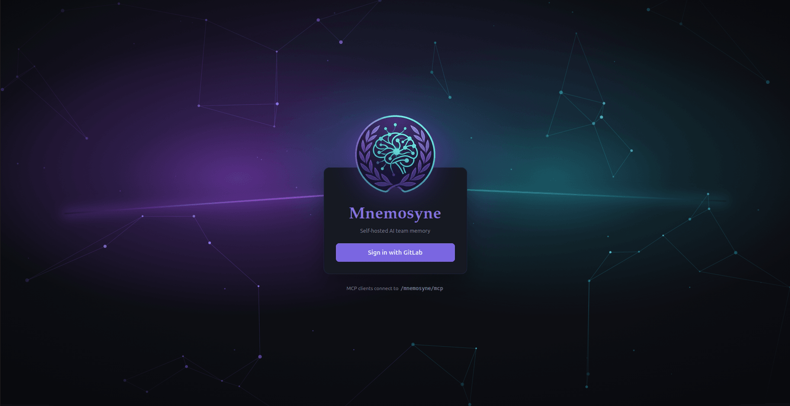
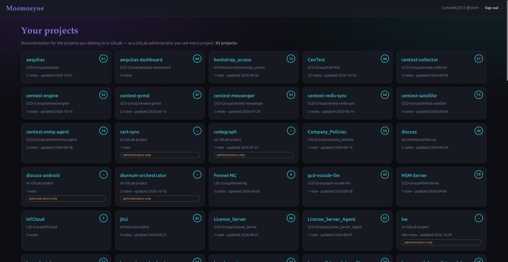
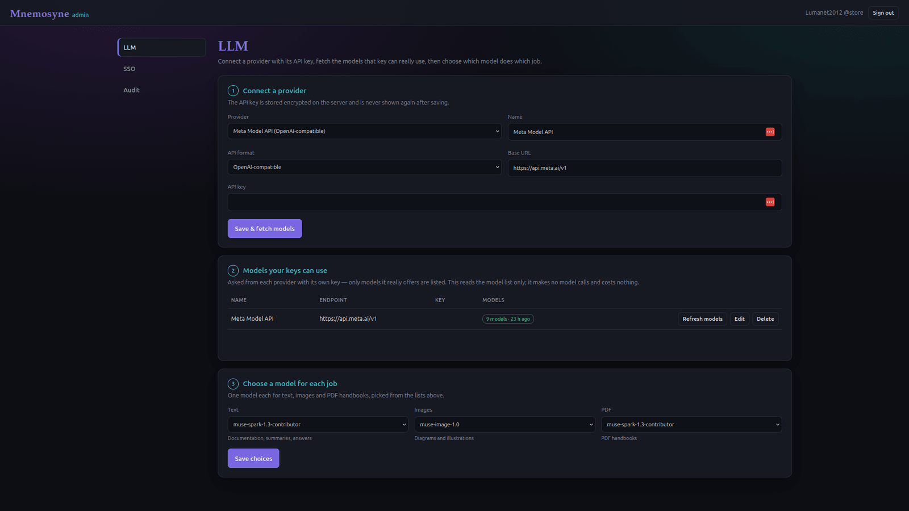
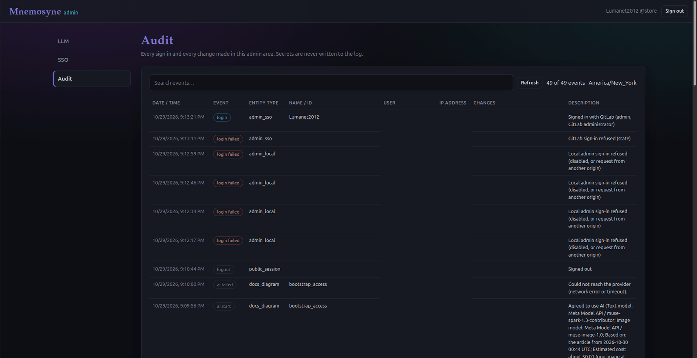

<p align="center">
  
</p>

# mnemosyne

Self-hosted **AI team memory**. A git-backed graph of memory *nodes* — what is where, what
state it's in, when it was done, how — that any MCP-capable AI reads and writes, with a thin
VSCode client for humans.

- **Source of truth:** markdown files with YAML frontmatter in a git repo. `git log` is the
  audit trail.
- **Search:** embedded SQLite — FTS5 (lexical) + `sqlite-vec` (semantic), fused with RRF.
  No search daemon, ~tens of MB resident.
- **Interfaces:** one core behind three façades — MCP over stdio, MCP over Streamable-HTTP
  (bearer), and plain REST.
- **Model-agnostic:** mnemosyne never calls an LLM to serve a read or write. Embeddings and
  the optional `extract` / `/ask` features target any OpenAI-compatible gateway; with none
  configured it runs fully offline.
- **No private infrastructure dependencies.** Git is the only hard requirement.

## Screenshots

### 1. Sign in with GitLab



The public entry page. Everyone signs in with their own GitLab account; Mnemosyne never keeps a separate password list. After signing in, a person only sees the documentation of the GitLab projects they belong to (GitLab administrators see every project). MCP clients connect to `/mnemosyne/mcp`.

### 2. Your projects



The home page after sign-in: one card for every GitLab project the person belongs to, five per row. The turquoise ring in the corner is the project's GitLab ID (a dash means no GitLab project matches the notes; those cards are visible to administrators only). Each card shows the GitLab path, the number of notes and the date of the last update. A project page shows the generated documentation: product description, hardware and software requirements, disaster recovery and the change history of the latest notes.

### 3. Admin: connect an AI provider in three steps



GitLab instance administrators connect an AI provider: (1) enter the provider and its API key (stored encrypted, never shown again), (2) fetch the models that key can really use (this only reads the model list and costs nothing), (3) choose one model each for text, images and PDF handbooks. Nothing in Mnemosyne calls a model unless an administrator presses a button and agrees to the estimated cost in a popup.

### 4. Admin: audit trail



Every sign-in, failed sign-in and change in the admin area, and every AI agreement and run, is written to an audit log (date, event, entity, name, description; user and IP address are blacked out in this picture on purpose). Secrets are never written to the log.

## Quick start

```bash
npm install
npm run build

# one-time: build the index from the corpus
node packages/server/dist/bin/mnemosyne.js reindex --repo .

# shared HTTP server: serves http://127.0.0.1:40000/mnemosyne
#   MCP at  /mnemosyne/mcp    REST under  /mnemosyne/
MNEMOSYNE_BEARER_TOKEN=secret npm run serve

# or per-user, editor-spawned:
node packages/server/dist/bin/mnemosyne.js serve --stdio --repo .
```

## Connect an AI

MCP-capable client (Claude Code, Continue, Cline, ...):

```jsonc
// HTTP (shared) — one :40000 endpoint, path-routed per service
{ "mcpServers": { "mnemosyne": { "url": "http://host:40000/mnemosyne/mcp",
                                 "headers": { "Authorization": "Bearer secret" } } } }
// stdio (local)
{ "mcpServers": { "mnemosyne": { "command": "mnemosyne", "args": ["serve", "--stdio"] } } }
```

Non-MCP client: `POST /mnemosyne/search` to pull nodes into the prompt,
`POST /mnemosyne/nodes` to write back.

## Tools

`search_memory` · `get_node` · `get_node_history` · `create_node` · `update_node` ·
`link_nodes` · `link_node_to_code` · `neighbors` · `reindex`

See [docs/architecture.md](docs/architecture.md) and [docs/self-hosting.md](docs/self-hosting.md).

## License

MIT © GCD Group
